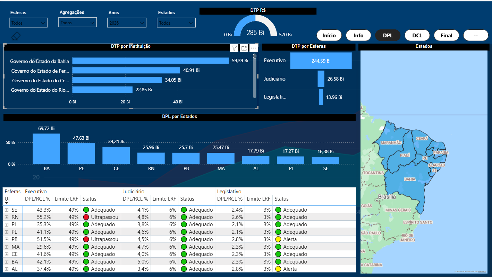

# Extrator de Dados Fiscais do Siconfi (RGF e RREO)

> Script em Python que coleta automaticamente os relatórios fiscais de estados e municípios
> no Siconfi (Tesouro Nacional) e organiza tudo em uma única base, este script foi utilizado como "base" dentro 
> do google sheets para atualizações automáticas no Power BI.



## Objetivo

Baixar os relatórios fiscais um por um no site do Tesouro é lento e cansativo.
Este script automatiza essa coleta, pois busca os dados de vários estados do Nordeste (NE), 
anos e Poderes de uma só vez e junta tudo em uma tabela organizada.

## 🗂️ Dados

- **Fonte:** [Siconfi – Tesouro Nacional](https://siconfi.tesouro.gov.br/) (dados públicos)
- **Relatórios:**
  - **RGF** – Relatório de Gestão Fiscal
  - **RREO** – Relatório Resumido da Execução Orçamentária
- **Abrangência:** estados do Nordeste (AL, MA, PI, SE, BA, entre outros)
- **Poderes:** Executivo (E), Legislativo (L) e Judiciário (J)

## Como funciona

1. Define os anos e períodos desejados
2. Para cada estado (pelo código do IBGE) e cada Poder, busca o relatório na API do Siconfi
3. Junta todas as tabelas em uma base única com `pandas`
4. A base final alimenta o painel no Power BI (pasta `BI_RGF`)

Exemplo do código:

```python
# 27 - Alagoas (AL)
DF_AL_RGF  = get_fiscal(year=ANOS, period=PERIODOS, cod=27, power=["E"])

df_RGF_total = pd.concat([DF_AL_RGF, DF_SE_RGF, DF_BA_RGF])
```

## Ferramentas

- Python 3.15
- siconfipy (acesso à API do Siconfi)
- pandas
- Jupyter Notebook
- Power BI

## Como executar

```Terminal
pip install siconfipy pandas
```

Depois, abra o notebook da pasta `Script - final` e execute as células em ordem.

## Autor

**Alexandre Albuquerque** – Economista | Mestrando em Economia Aplicada (UFAL)
- [LinkedIn](https://www.linkedin.com/in/alexandre-albuquerque-1814852a7/) 
- [GitHub](https://github.com/alexandre-albuquerque17)